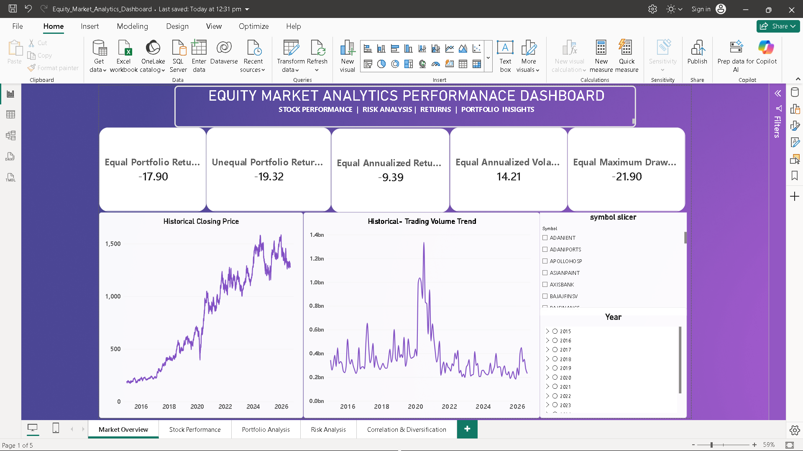
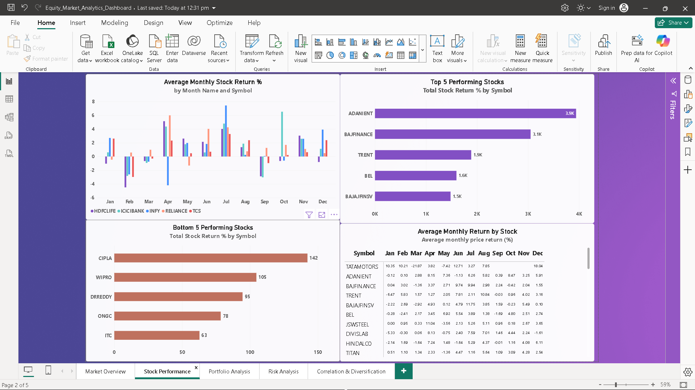
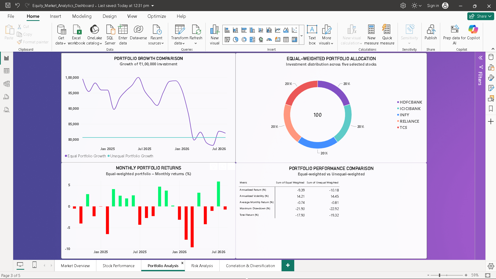
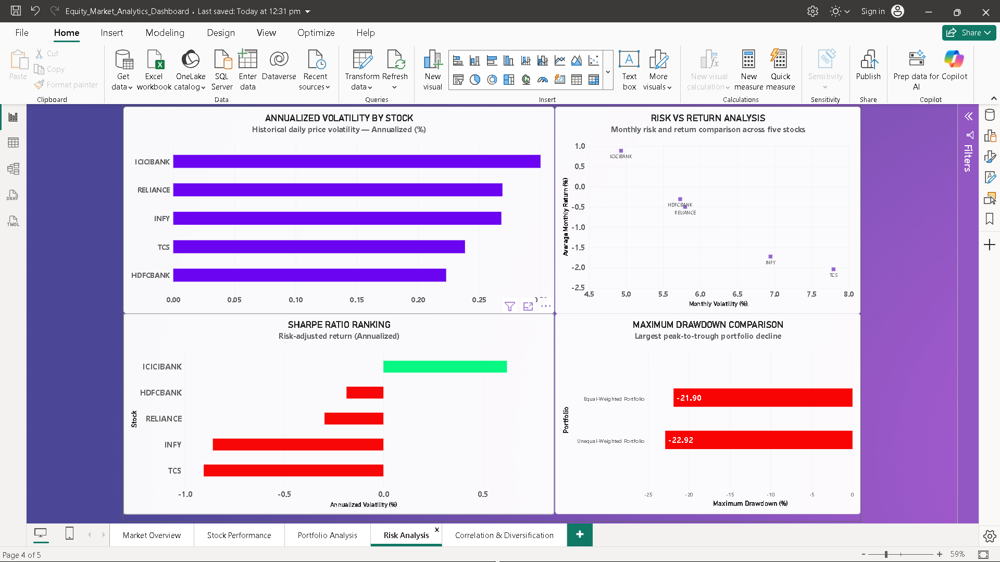
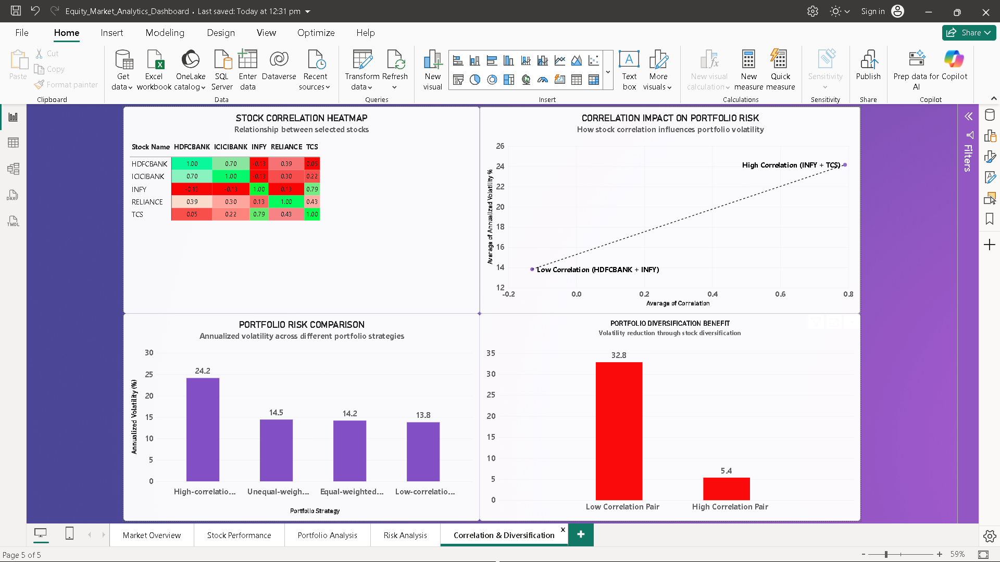

# Equity Market Analytics

## Project Overview

An end-to-end Equity Market Analytics project using **Python, SQL, MySQL, and Power BI** to analyze historical stock market data, evaluate stock performance, understand portfolio risk, and explore diversification opportunities.

This project demonstrates practical data analytics skills, including data cleaning, exploratory data analysis, SQL querying, financial metrics calculation, and interactive dashboard development.

## Tools & Technologies

- **Python:** Pandas, NumPy, Matplotlib
- **Database:** MySQL
- **SQL:** Data quality checks, stock performance, trading volume, volatility, and drawdown analysis
- **Power BI:** Interactive dashboards and data visualization
- **Jupyter Notebook:** Python analysis and documentation

## Project Structure

- `Python/` – Python analysis notebook and documentation
- `SQL_Queries/` – SQL analysis scripts
- `SQL_results/` – SQL query result files
- `Power Bi/` – Power BI dashboard
- `Power Bi/Screenshots/` – Dashboard page screenshots
- `Data/Analysis_Outputs/` – Portfolio analysis CSV outputs
- `Reports/` – Project analysis report

*Note: Folder organization in this repository may differ from the original local project structure.*

## Power BI Dashboard

The dashboard contains five analytical pages:

1. **Market Overview** – Overall market performance and key indicators.
2. **Stock Performance** – Comparison of individual stock performance.
3. **Portfolio Analysis** – Portfolio returns, allocation, and growth.
4. **Risk Analysis** – Volatility, Sharpe ratio, and maximum drawdown.
5. **Correlation & Diversification** – Stock correlations and diversification benefits.

## Key Analysis Areas

- Historical stock price analysis
- Annual and monthly stock performance
- Trading volume analysis
- Stock volatility measurement
- Maximum drawdown analysis
- Portfolio performance comparison
- Risk-return analysis
- Correlation and diversification analysis

## Project Highlights

- Analysed historical equity market data using Python and SQL.
- Performed data quality checks and analytical calculations.
- Compared portfolio performance under different weighting approaches.
- Evaluated risk and diversification using historical stock returns.
- Developed a five-page interactive Power BI dashboard.

 ## Power BI Dashboard Preview

### 1. Market Overview

### 2. Stock Performance

### 3. Portfolio Analysis

### 4. Risk Analysis

### 5. Correlation & Diversification

## Important Note

This project is for educational and analytical purposes only. Historical market performance does not guarantee future returns. It is not investment advice.

## Author

**Vinay Kumar**

GitHub: [Vinay1294](https://github.com/Vinay1294)

Project Repository: https://github.com/Vinay1294/equity-market-analytics
